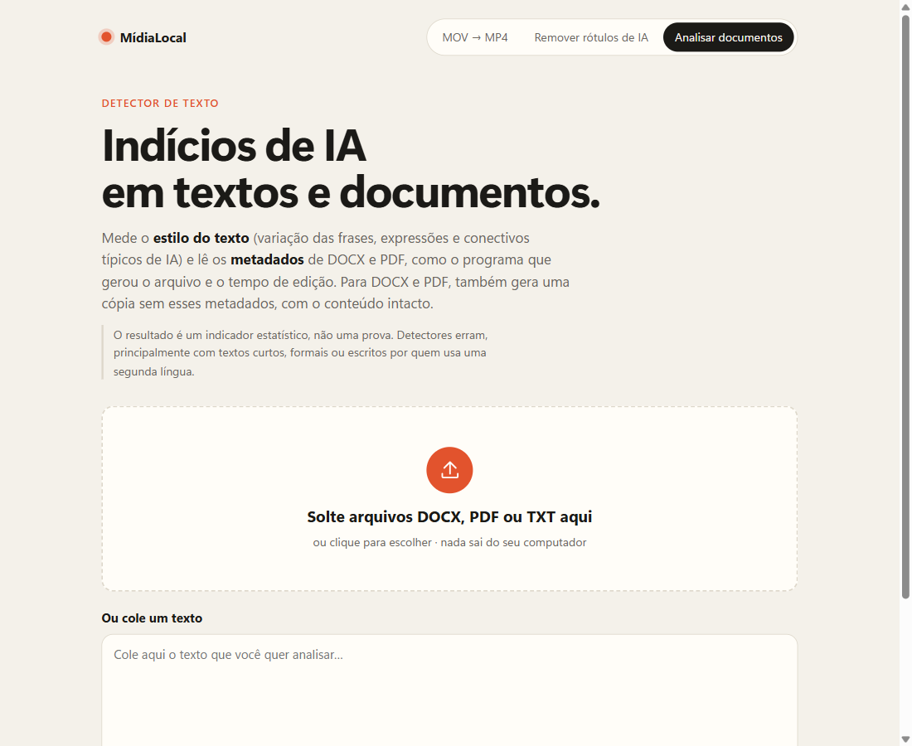
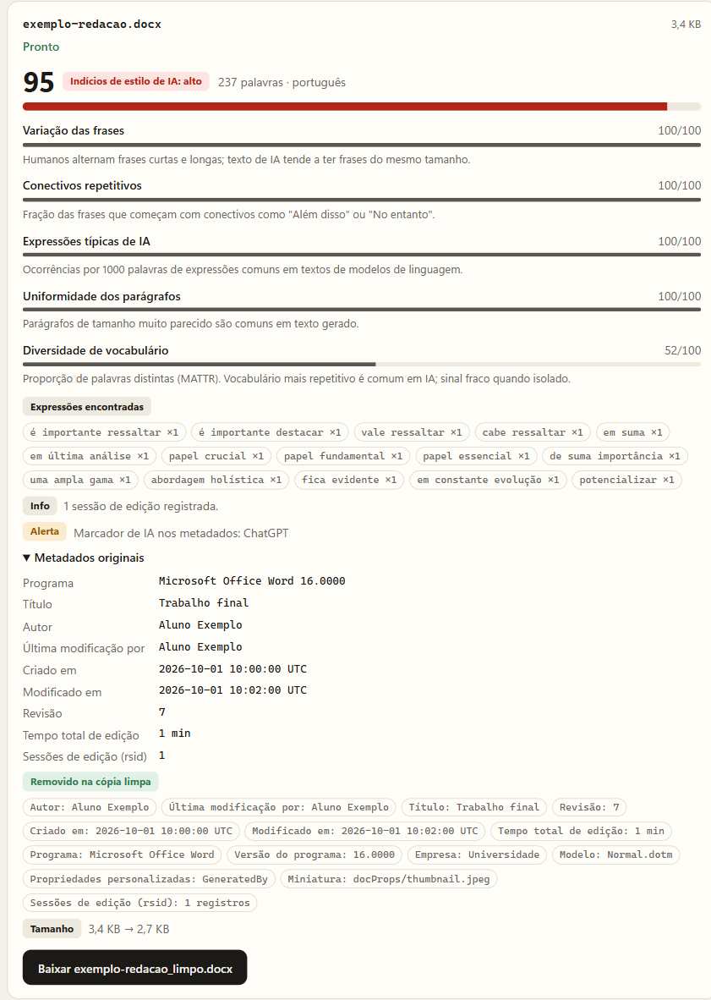

<div align="center">

# 🟠 MídiaLocal

**Ferramentas de mídia e documentos que rodam 100% no seu computador.**

Converta MOV para MP4 sem perder qualidade, remova os rótulos de IA dos metadados de fotos e vídeos, e analise textos, DOCX e PDF em busca de indícios de IA.




</div>

---

## ✨ O que ele faz

| Página | Para quê |
|---|---|
| **MOV → MP4** (`/`) | Converte vídeos `.mov` para `.mp4` **sem recompressão** sempre que possível. Só recodifica, em qualidade visualmente sem perdas, quando o codec não cabe em MP4 (ProRes, por exemplo). |
| **Remover rótulos de IA** (`/limpar`) | Tira de fotos e vídeos as Credenciais de Conteúdo **C2PA**, o campo IPTC `DigitalSourceType`, XMP, EXIF e os prompts embutidos. Pixels e áudio ficam idênticos. |
| **Analisar documentos** (`/documentos`) | Mede **indícios de IA no estilo do texto** e lê os **metadados** de DOCX e PDF. Também gera uma cópia do documento sem esses metadados, com o conteúdo intacto. |

> 🔒 **Privacidade:** o servidor escuta só em `127.0.0.1`. Nenhum arquivo ou texto sai da sua máquina, e não há chamadas para APIs externas.

---

## 🚀 Como rodar

### 1. Instale o que precisa

| Programa | Obrigatório? | Como instalar no Windows |
|---|---|---|
| **[Node.js](https://nodejs.org/) 22.13+** | Sim | `winget install OpenJS.NodeJS.LTS` ou o instalador "LTS" do site |
| **[FFmpeg](https://ffmpeg.org/)** | Só para vídeos | `winget install Gyan.FFmpeg` |

No macOS: `brew install node ffmpeg`. No Linux (Debian/Ubuntu), instale o Node 22+ pelo [nodejs.org](https://nodejs.org/en/download) e o FFmpeg com `sudo apt install ffmpeg`.

> Sem o FFmpeg, o site funciona normalmente para **fotos e documentos**. Só as funções de vídeo ficam desativadas, com um aviso explicando como ativar.

### 2. Baixe o projeto

- **Sem git:** clique no botão verde **Code → Download ZIP** aqui no GitHub e extraia a pasta.
- **Com git:**
  ```bash
  git clone https://github.com/PietroGranzottii/M-dia-Local.git
  cd M-dia-Local
  ```

### 3. Abra

**Windows:** dê dois cliques em **`iniciar.bat`**. Ele confere se o Node está instalado e na versão certa, instala as dependências na primeira vez, sobe o servidor e abre o navegador. Para parar, feche a janela preta.

**macOS / Linux / terminal:**

```bash
npm install
npm start
```

O navegador abre sozinho em **http://localhost:3000**. Para parar, use `Ctrl+C` no terminal.

### Configuração (opcional)

| Variável | Padrão | Para quê |
|---|---|---|
| `PORT` | `3000` | Porta do servidor |
| `FFMPEG_PATH` | `ffmpeg` | Caminho do executável do FFmpeg |
| `FFPROBE_PATH` | `ffprobe` | Caminho do executável do ffprobe |
| `MIDIALOCAL_TMP` | `./tmp` | Pasta dos arquivos temporários (é apagada a cada início) |

---

## 🔍 Como funciona o detector de texto



O detector combina **dois tipos de sinal**, mostrados separadamente.

### 1. Estilo do texto

Cada indicador recebe uma nota de 0 a 100, em que 100 significa "mais parecido com IA". A pontuação final é a média ponderada:

| Indicador | O que mede | Peso |
|---|---|---|
| Variação das frases | Coeficiente de variação do tamanho das frases (*burstiness*) | 30% |
| Expressões típicas de IA | Ocorrências por 1000 palavras de uma lista PT/EN ("é importante ressaltar", "desempenha um papel crucial", "delve"…) | 30% |
| Conectivos repetitivos | Frases que começam com "Além disso", "No entanto", "Moreover"… | 20% |
| Uniformidade dos parágrafos | Variação do tamanho dos parágrafos | 10% |
| Diversidade de vocabulário | MATTR (*moving-average type-token ratio*) | 10% |

A nota final fica em **baixo** (< 35), **médio** (35–64) ou **alto** (≥ 65). Com menos de 150 palavras aparece um aviso de baixa confiabilidade. Os limites ficam como constantes no topo de [`lib/textstats.js`](lib/textstats.js), fáceis de ajustar.

### 2. Metadados do arquivo

- **DOCX:** programa que gerou o arquivo, autor, datas, revisões, **tempo total de edição** e **número de sessões de edição** (`rsid`). Há alerta quando o tempo de edição é curto demais para o tamanho do texto, o que sugere texto colado.
- **PDF:** Title, Author, Producer, Creator, datas e o `CreatorTool` do XMP.
- **Ambos:** procura marcadores como ChatGPT, Copilot, Gemini e Claude, mas **só nos metadados**, nunca no corpo do texto.

<br clear="right">

> ⚠️ **O resultado é um indicador estatístico, não uma prova.** Detectores de IA erram, principalmente com textos curtos, formais ou escritos por quem usa uma segunda língua. Use o resultado como ponto de partida para uma conversa, nunca como veredito.

---

## 🧹 O que cada limpeza remove

<details>
<summary><b>Fotos (JPEG, PNG, WebP)</b></summary>

- **JPEG:** remove os segmentos de metadados (EXIF, XMP, IPTC, C2PA/JUMBF, comentários) e as imagens secundárias anexadas no fim do arquivo. Mantém o perfil de cor ICC, o segmento Adobe (necessário para CMYK) e a **orientação** da foto.
- **PNG:** mantém só os blocos de imagem e de cor. Remove blocos de texto (onde ficam prompts do Stable Diffusion e do ComfyUI), XMP, EXIF, C2PA (`caBX`) e a data.
- **WebP:** remove EXIF, XMP e C2PA e mantém imagem, transparência, animação e perfil de cor.

Os dados comprimidos da imagem são copiados byte a byte, sem recompressão.
</details>

<details>
<summary><b>Vídeos (MP4, MOV, M4V, WebM, MKV)</b></summary>

O FFmpeg copia as faixas de vídeo e áudio (`-c copy`) e descarta os metadados globais, os de cada faixa e os capítulos, em modo *bitexact*. Não há recompressão.
</details>

<details>
<summary><b>DOCX</b></summary>

- `core.xml`: autor, último editor, título, assunto, palavras-chave, descrição e última impressão. A revisão volta para 1 e as datas passam para a data de agora.
- `app.xml`: tempo total de edição, programa, versão, empresa, gerente e modelo.
- `custom.xml` (propriedades personalizadas) e a miniatura de pré-visualização.
- Todos os identificadores de sessão de edição (`rsid`).

Texto, formatação, imagens, comentários e alterações controladas não mudam.
</details>

<details>
<summary><b>PDF</b></summary>

Remove o dicionário Info e o stream XMP e **regrava o arquivo inteiro**, para que não sobre cópia antiga dos metadados, como sobraria numa atualização incremental. O conteúdo das páginas não muda.
</details>

**O que não é alterado:** marcas d'água visíveis ou embutidas no próprio conteúdo, como o SynthID nos pixels de uma imagem, continuam no arquivo.

---

## 🗂️ Estrutura do projeto

```
├── server.js            # servidor HTTP (node:http puro), rotas e fila de tarefas
├── iniciar.bat          # atalho para Windows
├── lib/
│   ├── video.js         # conversão MOV → MP4 e limpeza de vídeo (FFmpeg)
│   ├── image.js         # limpeza de JPEG, PNG e WebP sem recompressão
│   ├── scan.js          # busca de marcadores de IA em metadados
│   ├── textstats.js     # heurísticas de estilo do texto
│   ├── docx.js          # leitura e limpeza de DOCX
│   └── pdf.js           # leitura e limpeza de PDF
├── public/              # front-end em HTML, CSS e JS puros
├── test/                # testes com node:test
└── docs/                # especificação, plano e imagens do README
```

### API

| Método | Rota | Descrição |
|---|---|---|
| `POST` | `/api/convert` | Envia um `.mov` (corpo binário + cabeçalho `X-Filename`) e cria uma tarefa |
| `POST` | `/api/clean` | Envia uma foto ou vídeo para limpeza e cria uma tarefa |
| `POST` | `/api/document` | Envia um `.docx` ou `.pdf` (até 50 MB) para análise e limpeza |
| `POST` | `/api/analyze-text` | Recebe `{ "text": "..." }` (até 1 MB) e responde o relatório na hora |
| `GET` | `/api/jobs/:id` | Status e resultado de uma tarefa |
| `GET` | `/api/download/:id` | Baixa o arquivo gerado (disponível por 1 hora) |

---

## 🧪 Testes

```bash
npm test
```

São 26 testes: as heurísticas de texto, a leitura e limpeza de DOCX e PDF (com arquivos gerados na hora) e as rotas da API, inclusive o funcionamento sem FFmpeg. O teste das rotas sobe o servidor de verdade nas portas 3998 e 3999.

---

## ❓ Problemas comuns

| Sintoma | Solução |
|---|---|
| "O Node.js não está instalado" | Instale o Node LTS e **abra o `iniciar.bat` de novo**. Se acabou de instalar, feche e reabra o terminal. |
| "precisa do Node.js 22.13 ou mais novo" | Atualize com `winget upgrade OpenJS.NodeJS.LTS` |
| Vídeos dão erro "FFmpeg não está instalado" | `winget install Gyan.FFmpeg` e reinicie o MídiaLocal |
| "O MídiaLocal já está rodando" | Já existe uma janela aberta, e o navegador vai apontar para ela. Para reiniciar, feche a outra janela. |
| A porta 3000 está ocupada por outro programa | Rode com outra porta: `set PORT=3100 && node server.js --open` (Windows) ou `PORT=3100 npm start` |
| Erro ao instalar dependências | Verifique a internet, apague a pasta `node_modules` e tente de novo |

---

## 🛠️ Feito com

- [Node.js](https://nodejs.org/), sem framework web
- [FFmpeg](https://ffmpeg.org/) para vídeo
- [pdf.js](https://github.com/mozilla/pdf.js) para ler PDFs
- [pdf-lib](https://pdf-lib.js.org/) para regravar PDFs
- [fflate](https://github.com/101arrowz/fflate) para abrir e regravar DOCX

---

## 📄 Licença

Distribuído sob a licença [Apache 2.0](LICENSE): você pode usar, modificar e redistribuir, inclusive comercialmente, mantendo o aviso de licença e indicando as alterações feitas.
